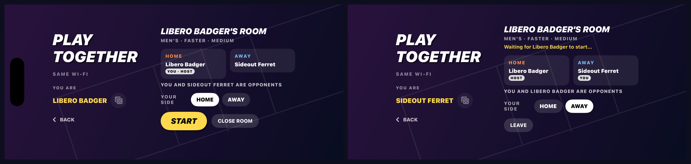

# Playtest 4 checklist: two phones on the same Wi-Fi

The first build where two people play one match: JD and his son, each on their own iPhone, on the
same Wi-Fi, as teammates or as opponents, with bots in the other ten spots. One phone hosts the
match. Install the build on both phones from TestFlight ("Family and Friends"). Short notes are
fine: which phone, roughly when, and what felt off.

## Before you start

- [ ] Both phones are on the **same Wi-Fi** (not one on cellular, not a guest network that keeps
      devices apart).
- [ ] The first time, each phone asks to **find devices on your local network**. Tap **Allow**.
      If someone tapped Don't Allow: Settings → Spike Jam → Local Network → on.
- [ ] Both phones have the same build (TestFlight shows the build number). A phone with another
      build is turned away in the lobby.

## Host and join

- [ ] On the first phone: **PLAY TOGETHER** → **HOST A MATCH**. Pick men's or women's, a speed
      and a level, then **OPEN THE ROOM**.
- [ ] Each phone has a generated nickname ("Pancake Otter"). Tap the dice to get another one. There's
      nowhere to type a name, which is on purpose.
- [ ] On the second phone: **PLAY TOGETHER** → **JOIN A MATCH**. The host's nickname shows up in the
      list within a few seconds. Tap **JOIN**.
- [ ] Both phones show the room: who's on **HOME** and who's on **AWAY**.

## Teammates, then opponents

- [ ] **Teammates:** both phones pick the same side. The lobby says "YOU AND … ARE TEAMMATES".
      The host taps **START**. Play a match.
- [ ] Do your own touches feel as instant as in a solo match, on both phones? (The guest's
      touches are predicted on its own phone, so they should.)
- [ ] When your teammate touches the ball, does it ever jump or slide oddly on your screen?
- [ ] **Opponents:** back to the menu, then open a new room, and this time pick different sides. The
      lobby says "OPPONENTS". Play a match.
- [ ] Kills, points and the score: do they ever show and then get taken back? (They should wait
      for the host, so they never do.)
- [ ] The score reads **YOU** for your own side on both phones.
- [ ] At the end, the host can tap **PLAY AGAIN** and the guest follows into the new match. The
      guest's card says it's waiting for the host.

## A drop and a rejoin

- [ ] Mid-rally on the **guest** phone: swipe home (or lock it) for about 5 seconds, then come back.
- [ ] On the host, a banner says the guest dropped and a bot took over. The bot keeps playing
      their player.
- [ ] Back on the guest, it reconnects by itself within a couple of seconds, on the same side.
      Your pick goes back to BALL until the next huddle. Pick again there.
- [ ] Turn Wi-Fi off on the guest for about 5 seconds, then on again. Same as above?

## The host leaving the screen

- [ ] Mid-rally on the **host** phone: swipe home for about 5 seconds, then come back.
- [ ] The guest freezes with **HOST PAUSED** while the host is away.
- [ ] When the host comes back, both phones carry on from where they stopped (no skipped rally).
- [ ] Try a long one: the host away for 30 seconds or more. Does the guest pick up again within a
      few seconds of the host coming back?
- [ ] The host taps the **✕** and leaves: the guest shows **THE HOST LEFT** with a way back to the menu.

## Anything else

- [ ] Did anything feel laggy? Note which phone, and if the Wi-Fi was busy.
- [ ] Did a phone ever get stuck on "Joining…" or "Waiting for the host…"?
- [ ] Anything a kid found confusing in the lobby?
